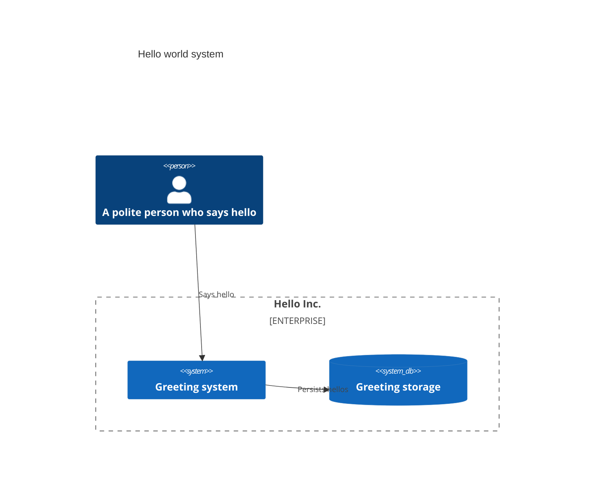

a drawio theme for c43.
rules

- nodes are always rectangular in 4:3 proportion
- node outline is 4x the line thickness of a connection
- node desc two/three-line: name (Greetings storage), semantic role (object store), description (optional, could span multiple lines). Text is centered. Format
    ```
    ** name **
    [ role ]
    description
    ```
- outer diagram's border is 2x of the thickness of a connection
- group's desc is bottom left inside the group and left aligned. Format:
    ```
    ** name **
    [ role ]
    ```
- user, db, store and bus have visual indicators from media/icons.svg
- icons "sit" on the top left corner of the node, half-width "hanging" outside
- db and bucket have a visual bulge at the bottom, but since it's a pseudo 3d bulge, the sit-on-the-node line is the virtual line connecting to bottom side nodes 

first test subject is cdk-arch's mermaid:


----- AI agent updates -------

## Decisions

- Pretty C4 is the only drawio look of c43 (`--drawio`, system and container); no theme flag, the plain look is dropped and the c43 goldens (`fixtures/layout-cases`, drawio CLI tests) are regenerated. Rejected: opt-in `--theme pretty` (two looks to maintain).
- The styling is scoped to c43 only. `clarc` and plain `c43-layout` do not use it: c43 keeps the drawing-strategy extension point (`Styler`) that clarc builds on, with its own strategy, and clarc pins a c43 revision. Only c43's built-in strategy becomes the pretty one. Nothing cloud-specific lives in c43.
- Node text: name = node name; role = the role the c43 output gives (task jet9f, "Roles In C43 Output"); until jet9f, interim rule: a node's role is its type, a group has a role only when given one. Description = optional, omitted until the model offers one (JSDoc extraction rejected for now). Rejected: deriving roles with a separate table in the drawio code.
- Geometry and strokes
  - Nodes stay squares, as the layout engine draws them. The 4:3 proportion rule was dropped. Rejected: drawing 4:3 inside the engine square (edge ends would need pulling in for nothing).
  - Connection line width = 1 unit `t`; node outline = 4t; outer diagram border = 2t. Group frames use the connection thickness.
  - Node text, centered, three parts: bold name, `[ role ]`, description (multi-line, optional, line omitted when empty). Node side is chosen so that the lines fit.
  - Group text is left aligned inside the group at its bottom left: bold name and `[ role ]` (group role e.g. enterprise boundary, system boundary). Replaces the current title at the top of the group frame. The role line is absent while the model has none.
  - The layout engine only knew a title band at the top of a group, so `c43-layout` gains an opt-in size hint `titleBottom` (default off: output of every existing input, and clarc, unchanged) that keeps the band at the bottom of the group (between the last row's lanes and the bottom border) and places the title block there. The band height comes from `titleHeight`; c43 sets it to the lines of the group text (2 when any group has a role, else 1). Rejected: top-left text in the existing band (deviates from the rule); post-processing group heights in c43 (edges and waypoints below would need shifting).
- Icons
  - Source: one drawio file per icon under `media/` (`user.drawio`, `db.drawio`, `store.drawio`, `bus.drawio`), built from native drawio shapes (ellipse, rounded rectangle, cylinder, trapezoid): the exported SVG/PNG then carries real vector shapes, no embedded images. The files are edited and saved with the drawio editor, uncompressed (compressed files are rejected with an error), vertices only; everything the XML says is read with a real XML parser, so editor formatting does not matter. The first cell is the icon: a transparent box with the icon's extent (id `i-<node>`; its size is the icon's size), its style carries `c43SitLine=<fraction>`, the part of its height that hangs below the sit line (db and store: 0.1; absent = 0); the following cells are its parts (`i-<node>-<n>`); drawing an icon moves those cells to the node. Editing a file needs a rebuild (the files are compiled in) and regenerated goldens. The files are compiled into the binary (self-contained output, nothing external). `media/icons.svg` stays as the original artwork the shapes imitate (user: head and shoulders; db: barrel; store: tapered barrel; bus: tube lying down, open end right). Rejected: inline `data:image/svg+xml` image cells (embedded raster-like images in exports; an experiment compared both and the native shapes were adopted); the native shapes are approximations (the user's shoulders are a rounded rectangle, the bucket's bottom is straight).
  - Mapping: an icon is a per-case hint, not derived by the renderer: a hints file next to the c43 dump lists `icons` by node id (`user`, `db`, `store`, `bus`), e.g. rebob: queue → bus, memory and event-storage → db, frontend and client → user. Interim until the c43 output carries the kind (jet9f). No hints → no icons (the CLI therefore draws none yet). Rejected: guessing from type or class names (fragile on real class names).
  - Placement: the icon sits on top of the node: its sit line on the node's top edge, overlapping the node's outline (the outline is centred on the edge; the icon box has the artwork's own proportions, no empty margin) (the sit line is the icon's bottom; for the barrel icons db and store the line joining the leftmost and rightmost points of the bottom oval, so the lower half of that oval hangs below the line, over the node), its horizontal centre on the node's left side (half of its width hanging outside); fixed size, 32 px. Node side is at least 5 units so the icon has room.
  - Nodes are always plain rectangles (squares); no other node shapes. An icon only adds type flavour; a db or store node is not drawn as a barrel. Rejected: barrel node shapes with a bulge below the square (an earlier decision, dropped).
- Test subjects are real c43 output: the cdk-arch sample's system output (the hello world: user, system, storage) and the two rebob dumps (system and container), each a case folder under `fixtures/layout-cases` holding `c43.json`, `hints.json` (icons) and the `expected.drawio` golden. The earlier router-derived `graph.json` of the rebob cases is dropped; the aws/groups/star16 layout cases stay as plain layout goldens. One synthetic case, `hello-world-mermaid`, is kept from the ticket's mermaid: it carries more than c43 generates (roles, person and database kinds, boundary group, relation labels), which is recorded in jet9f as scope.
- Acceptance: golden drawio for the existing cases regenerated to the pretty look (`UPDATE_GOLDEN=1` rewrites); c43-layout tests cover `titleBottom` (title inside the bottom border, below the members; top band still the default); c43 tests assert square nodes, stroke ratio 4:2:1 (node : outer border : connection), the name/role text of nodes and groups, icons only on hinted nodes, their sit line overlapping the node outline with half-width overhang (barrel icons lower by the hang of the bottom oval), all nodes plain squares, node side growing with the role.

- Dev aid: `scripts/render.sh` renders drawio files (default: every case under `fixtures/layout-cases`) to PNG and SVG in `./out` (git-ignored) with the drawio CLI.

## Open points

- Exported SVG text: node text and group text are html labels (bold name plus regular role) and the diagram title wraps, so the drawio CLI exports them as embedded PNG bitmaps in the `.svg` (icons stay vector, edge labels stay text); the `.drawio` itself is fine. Proposed fix, not decided: plain non-html text, name and role as separate cells with pre-wrapped lines, so the export has real text. Pending the user's decision.
- Edge labels sit above their line (not on it, so the line and the arrowhead stay visible) and a label wider than about 80 px is split into 2 or 3 lines of about equal width (a label that cannot be broken stays whole). Rejected for now: widening the lane to the label (needs the engine to take per-edge label widths, e.g. candidate widths for 1/2/3 lines, pick the first that fits within twice the current lane, anchor on the longest horizontal run; a c43-layout task if long labels still collide).
- Known limits, accepted for now: an icon sitting on a node near the top of a group can poke through the group's top border (no room is reserved above nodes); a split label can still be wider than a very narrow lane (the lane width is the engine's); a group's bottom text band can be crossed by an edge routed through the bottom lane.

- Depends on jet9f for node and group roles; until then there is no role source. c43 already reads an optional `role` node attribute (JSON `attributes.role`) and shows it when present, so the look works as soon as the output carries it.
- c43 depends on the unreleased `c43-layout` option `titleBottom` (local branch `title-bottom` there); c43's dependency points at the local path until c43-layout is committed and pushed, then it must be pinned to that revision again (release gate).

## Implementation (abstract)

- Model → pretty strategy: role read from the c43 output, icons from the per-case hints, label text built as name/role/description; node side from the widest line.
- Node cell = square with outline, optional icon cell; group cell = frame plus bottom-left text; the four icon drawio files are read from `media/` and their cells moved to the node; c43's default styler replaced, the extension point kept for clarc.
